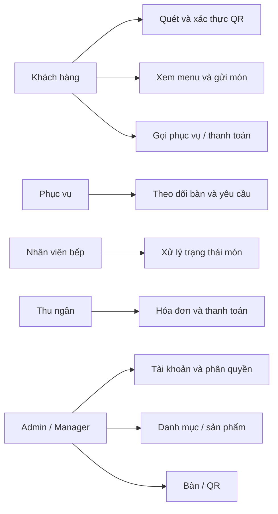
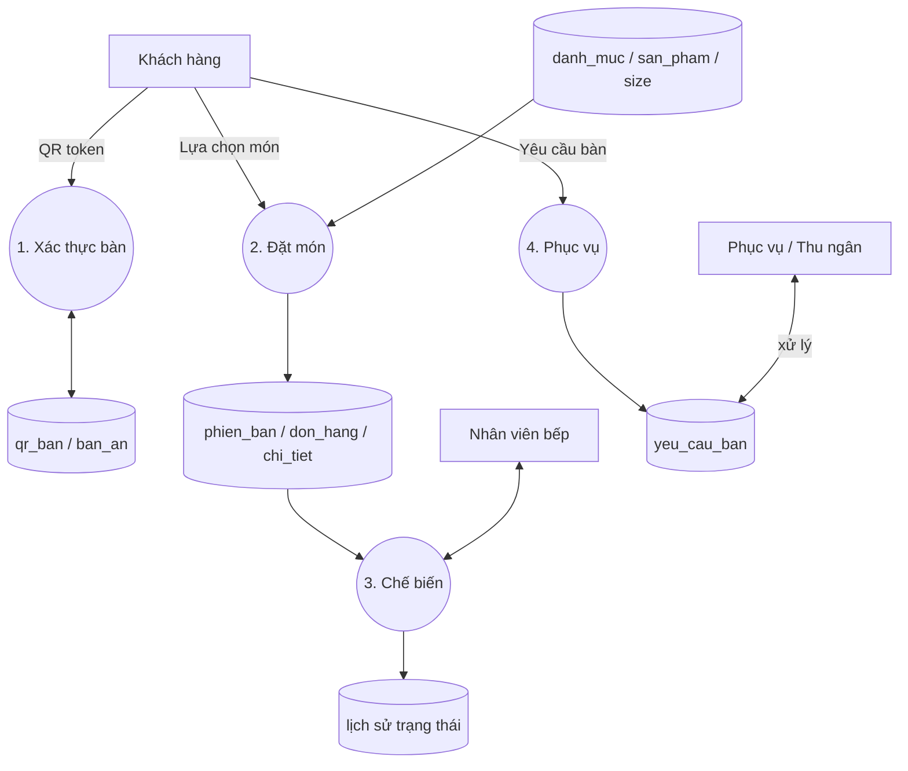
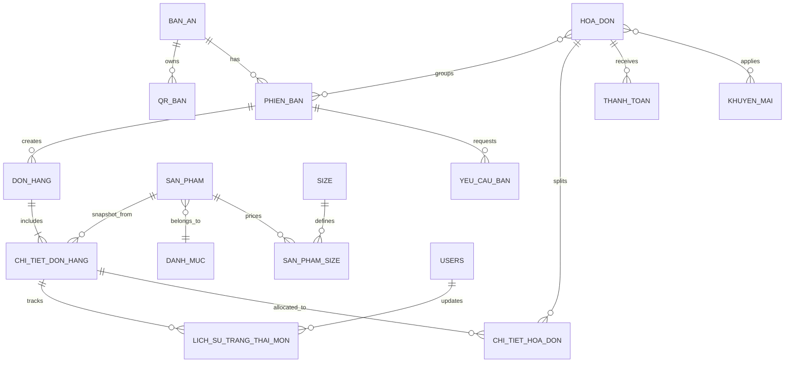

# Phân tích và thiết kế

## Use case tổng thể



## Phân quyền

| Route/Module | Admin | Manager | Cashier | Kitchen | Waiter | Customer |
|---|---:|---:|---:|---:|---:|---:|
| Dashboard | Có | Có | Có | Không | Có | Không |
| Danh mục/Sản phẩm/Bàn/QR | Có | Có | Không | Không | Không | Không |
| Màn hình bếp | Có | Có | Không | Có | Không | Không |
| Menu/giỏ hàng qua QR | Có token | Có token | Có token | Có token | Có token | Có token |
| API đặt món/yêu cầu | Có QR hợp lệ | Có QR hợp lệ | Có QR hợp lệ | Có QR hợp lệ | Có QR hợp lệ | Có QR hợp lệ |

## Sequence quét QR và gửi món

```mermaid
sequenceDiagram
  actor Customer
  participant Web
  participant QR as QrService
  participant Order as OrderService
  participant DB as MariaDB
  Customer->>Web: Mở /menu?token=random
  Web->>QR: validate(token)
  QR->>DB: SELECT token_hash, active, expiry, table
  DB-->>QR: Bàn hợp lệ
  Web-->>Customer: Menu từ database
  Customer->>Web: POST /api/orders + CSRF + items
  Web->>QR: Xác thực lại token
  Web->>Order: createOrder(table, items)
  Order->>DB: BEGIN; kiểm tra lại món/size/giá
  Order->>DB: Tạo phiên/đơn/chi tiết snapshot/thông báo
  Order->>DB: COMMIT
  Web-->>Customer: Mã đơn và tổng tiền
```

## DFD mức 1



## ERD cốt lõi



## Wireframe khách hàng (mobile)

```text
+--------------------------------+
| TableTap         Bàn 01   [bag] |
+--------------------------------+
| Thực đơn hôm nay               |
| Chọn món bạn thích.            |
| [Tất cả] [Cà phê] [Trà] ...    |
+---------------+----------------+
| [ảnh món]     | [ảnh món]      |
| Tên món       | Tên món        |
| từ 29.000  [+]| từ 39.000  [+] |
+---------------+----------------+
| Menu       Giỏ hàng    Thanh toán|
+--------------------------------+
```

## Wireframe vận hành

```text
+------------+-------------------------------------------+
| TableTap   | Tiêu đề / trạng thái hệ thống             |
| Tổng quan  +-------------------------------------------+
| Danh mục   | KPI  | KPI  | KPI  | KPI                  |
| Sản phẩm   +-------------------------------------------+
| Bàn / QR   | Sơ đồ bàn             | Yêu cầu khách     |
| Bếp        +-------------------------------------------+
| Tài khoản  | Danh sách đơn / bảng dữ liệu / thao tác   |
+------------+-------------------------------------------+
```

## Kiến trúc code

```text
public/index.php
  -> Controllers (route/web/API)
     -> Services (QR, order, upload)
        -> Core/Database (PDO)
           -> MariaDB
  -> Views/layouts + assets
```

